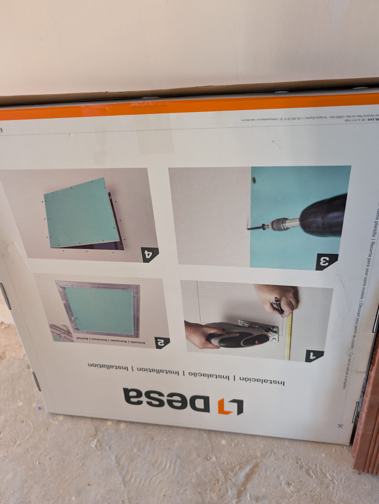

## Qué hice

Hoy toca prueba de flujo. He montado el bot que convierte notas de voz en posts, y este borrador es justo esa prueba: si lo estás leyendo, algo ha funcionado.

Funciona así: mando un mensaje de WhatsApp, se transcribe con Whisper a través de Groq, y Claude usa esa transcripción para generar el post del blog. Después se sube solo a GitHub y Hugo me genera la entrada. Todo está montado en workflows de n8n.

Por otro lado, he conseguido una forma mejor de esconder los colectores del suelo radiante.

## Veredicto WAF

Aprobado.
