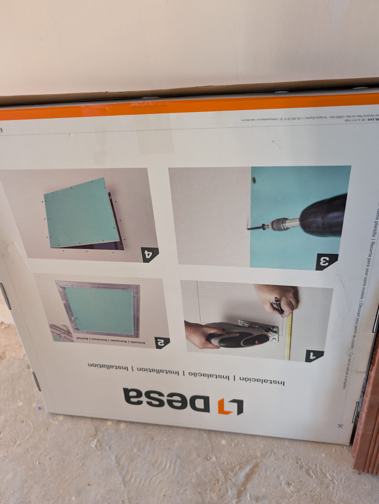

## What I did

Today is a flow test. I've set up the bot that turns voice notes into posts, and this draft is exactly that test: if you're reading this, something worked.

It works like this: I send a WhatsApp message, it gets transcribed with Whisper through Groq, and Claude uses that transcript to generate the blog post. Then it gets pushed to GitHub on its own and Hugo builds the entry for me. It's all set up in n8n workflows.

On another note, I've come up with a better way to hide the underfloor heating manifolds.

## WAF verdict

Approved.
